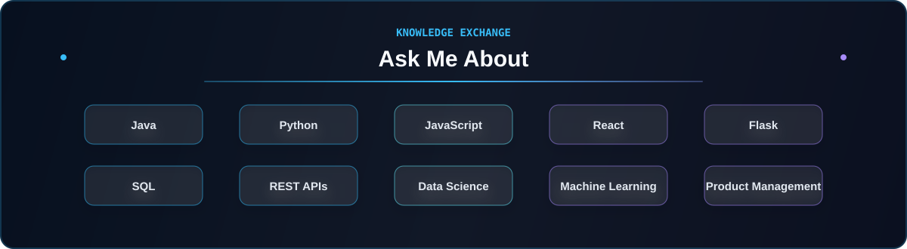

<!-- ===================================================== -->
<!-- SHAIk REHANA | GITHUB PROFILE README                   -->
<!-- ===================================================== -->

 

  

---

## 👩‍💻 About Me

Hi! I'm **Shaik Rehana**, a Computer Science and Data Science student passionate about building useful technology and meaningful digital experiences.

- 🎓 B.Tech in Computer Science and Engineering (Data Science)
- 💼 Full Stack Intern at **Brillon AI**
- 🌱 **Microsoft Learn Student Ambassador**
- 🤝 Lead of **JIGNASA – The Learning Club**
- 🤖 Interested in Artificial Intelligence and Machine Learning
- 💡 Exploring Product Management and product development
- 🚀 Enjoy learning, experimenting, and turning ideas into practical solutions

I believe technology is most powerful when it solves real-world problems and creates meaningful impact.

---

## 🚀 Currently Building

- Developing my full-stack development skills.
- Exploring AI and Machine Learning applications.
- Learning how to build user-focused digital products.
- Improving problem-solving and software development fundamentals.
- Collaborating and learning through the developer community.

---

## 🛠️ Engineering Toolkit

### Programming Languages

  
  
  

### Web Development

  
  
  
  
  
  

### Database & Tools

  
  
  
  
  

### Areas of Interest

  
  
  
  

---

## 💡 Project Spotlights

A selection of projects and concepts that reflect my interests in software development, AI, and problem-solving.

### 1. Examination Management System

A web-based examination platform designed for students and administrators.

- User authentication and role-based access.
- Exam and question management.
- Student exam attempts and result tracking.
- Backend APIs using Flask and SQLite.

**Tech:** Python · Flask · SQLite · HTML · CSS · JavaScript

### 2. Waste Track – Smart Waste AI

An AI-powered waste classification application that identifies waste categories from uploaded images.

- Image-based waste classification.
- Machine Learning-powered predictions.
- Classification history stored using SQLite.
- Interactive application built with Streamlit.

**Tech:** Python · Streamlit · Machine Learning · SQLite

### 3. Booking Management Backend API

A Paytm-inspired booking management backend that demonstrates REST API development and CRUD operations.

- Create, retrieve, update, and delete bookings.
- Backend API development using Express.
- API testing and frontend integration support.

**Tech:** Node.js · Express.js · JavaScript · REST APIs

### 4. JanSeva AI

A civic-tech concept focused on transforming citizen complaints into actionable insights.

- AI-assisted complaint prioritization.
- Ward-level issue analysis and heatmaps.
- Recommended actions and reporting.

**Focus:** AI · Data Analytics · Civic Tech · Product Thinking

---

## 🔍 Additional Project References

These are projects from the reference portfolio we discussed, included as learning and inspiration references rather than my own repositories.

| Project | Focus | Technologies |
|---|---|---|
| SaarLens | Explainable candidate-ranking engine | Python, Streamlit, Explainable AI |
| TutorLive | Real-time faculty selection platform | ASP.NET Core, SignalR, Azure |
| UiPath SDC Portal | Community portal concept | TypeScript, UiPath |

Original reference repositories:
- [JanSeva AI](https://github.com/shahid-afrid/janseva-ai)
- [SaarLens](https://github.com/shahid-afrid/saarlens-redrob-ranker)
- [UiPath SDC Portal](https://github.com/shahid-afrid/uipath-sdc-web)

---

## 📊 GitHub Contribution Activity

## ⚡ GitHub Statistics

  

---

## 🏆 Recognition & Achievements

- 🌟 Microsoft Learn Student Ambassador (MLSA).
- 🤝 Lead of JIGNASA – The Learning Club.
- 💼 Full Stack Intern at Brillon AI.
- 🚀 Actively building projects and exploring emerging technologies.

---

## 🌱 Exploring Next

- Advanced Java and Data Structures & Algorithms.
- Full Stack Development.
- Artificial Intelligence and Machine Learning.
- Product Strategy and Product Management.
- Building impactful, user-focused applications.

---

## 🤝 Let's Connect

I'm always interested in learning, collaborating, sharing ideas, and connecting with people who enjoy building meaningful technology.

  

**✨ Learning continuously. Building thoughtfully. Growing together.**

