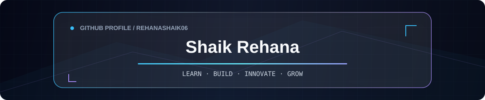

 

  
  
  
  

---

## 👩‍💻 About Me

Hey there! I'm **Shaik Rehana**, a Computer Science and Engineering student specializing in **Data Science** at **RGM College of Engineering and Technology (RGMCET)**.

- 💼 Currently working as a **Full Stack Intern at Brillon AI**.
- 🌐 Proud **Microsoft Learn Student Ambassador (MLSA)**.
- 📚 Lead of **JIGNASA – The Learning Club**.
- 🤖 Interested in Artificial Intelligence and Machine Learning.
- 💡 Passionate about Product Management, innovation and technology.
- 💻 Exploring Full Stack Development and building practical applications.
- 🤝 Enjoy collaborating, sharing knowledge and learning from the tech community.

I believe in continuously learning, experimenting with ideas and building technology that solves real-world problems.

---

## 🚀 Currently Building & Learning

- Building and improving full-stack applications.
- Exploring AI-powered applications and intelligent solutions.
- Strengthening Java and Python programming skills.
- Improving backend development and database management.
- Practicing Data Structures and Algorithms.
- Exploring product thinking, user needs and problem-solving.
- Learning through internships and developer communities.

 

---

## 🛠️ Engineering Toolkit

### Programming Languages

  

### Frameworks & Libraries

  

### Databases & Developer Tools

  

### Areas of Interest

  
  
  
  
  

---

## 🌟 Featured Projects

### 1. Examination Management System

A web-based examination management application designed to simplify online examination workflows.

**Key Features**
- User authentication and role-based access.
- Student and administrator functionality.
- Exam creation and management.
- Question management and exam attempts.
- Result generation and management.

**Tech Stack:** Python, Flask, SQLite, HTML, CSS, JavaScript.

### 2. Waste Track – Smart Waste AI

An AI-powered waste classification application designed to identify waste categories through image classification.

**Key Features**
- Upload images for waste classification.
- Predicts waste categories.
- Displays prediction confidence.
- Maintains classification history.
- Interactive Streamlit interface.

**Tech Stack:** Python, Streamlit, Machine Learning, SQLite.

### 3. Booking Management Backend API

A Paytm-inspired backend application providing REST APIs for booking management.

**Key Features**
- Create, retrieve, update and delete bookings.
- REST API architecture.
- JSON-based request and response handling.
- Backend API deployment.

**Tech Stack:** Node.js, Express.js, JavaScript, REST APIs.

### 4. JanSeva AI

An AI-powered citizen grievance and constituency intelligence platform concept.

**Key Focus Areas**
- Citizen grievance management.
- Data-driven issue analysis.
- AI-powered insights.
- Technology-driven public service solutions.

**Areas:** Artificial Intelligence, Data Analytics, Product Thinking and Full Stack Development.

---

## 📊 GitHub Statistics

 

 

---

## 🏆 Achievements & Recognition

- 🏅 **Microsoft Learn Student Ambassador (MLSA)**.
- 🎯 **SAP Hackfest 2026 Finalist**.
- 📜 **UiPath Certified Professional – Automation Developer Associate**.
- 🚀 **Full Stack Intern at Brillon AI**.
- 🌟 Lead of **JIGNASA – The Learning Club**.

---

## 🌱 My Learning Journey

- Artificial Intelligence and Machine Learning.
- Generative AI and intelligent applications.
- Full Stack Application Development.
- Java and Data Structures & Algorithms.
- Database Management and Backend Development.
- Product Thinking and Innovation.
- Building impactful technology solutions.

 

---

## 💬 Ask Me About

---

## 🤝 Let's Connect!

I'm always excited to connect with developers, innovators, learners and technology enthusiasts.

Whether it's collaborating on projects, discussing ideas, exploring AI or sharing knowledge, let's connect and grow together!

  

  

### Thanks for visiting my profile! 💙

**Keep Learning. Keep Building. Keep Growing.**

