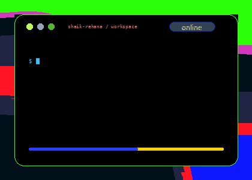

 

 

## About Me

**Full Stack Intern at Brillon AI** and a third-year Computer Science and Engineering (Data Science) undergraduate at **RGM College of Engineering and Technology (RGMCET)**.

- **Microsoft Learn Student Ambassador (MLSA)**
- Lead of **JIGNASA – The Learning Club**
- Building across **Full Stack Development, AI and Machine Learning**
- Interested in products that turn ideas into practical technology solutions
- Exploring **Product Management, innovation and technology**

As a technology enthusiast, I enjoy exploring new ideas and developing applications that create meaningful real-world impact through technology.

**Proof of work:** examination management systems, AI-powered waste classification applications, backend APIs and full-stack development projects.

**Strengths:** Leadership · Communication · Collaboration · Product Thinking · Problem-Solving

 

## Currently Building

- Full Stack applications and practical web solutions
- AI-powered applications and intelligent systems
- Backend APIs and database-driven applications
- Java and Python programming
- Data Structures and Algorithms
- Machine Learning and Data Science concepts
- Exploring product development and user-focused solutions

 

  

## Engineering Toolkit

### Core Engineering

### AI & Data

 

### Backend & Development

 

### Tools

## Project Spotlights

### [Examination Management System](https://github.com/Rehanashaik06/examination-management-system)

A web-based examination management application designed to simplify online examination workflows for students and administrators.

- User authentication and role-based access
- Admin and student functionality
- Examination and question management
- Exam attempts and result generation
- Backend API integration and database management

`Python` · `Flask` · `SQLite` · `HTML` · `CSS` · `JavaScript`

### Waste Track – Smart Waste AI

An AI-powered waste classification application that identifies waste categories through image classification.

- Image-based waste classification
- Machine Learning-powered predictions
- Prediction confidence display
- Classification history tracking
- Interactive Streamlit application

`Python` · `Streamlit` · `Machine Learning` · `SQLite`

### [Booking Management Backend API](https://paytm-backend-zkbw.onrender.com)

A Paytm-inspired backend application that demonstrates REST API development and booking management operations.

- Create and manage bookings
- Retrieve booking information
- Update and delete booking records
- REST API architecture
- Backend deployment

`Node.js` · `Express.js` · `JavaScript` · `REST APIs`

### Full Stack Development

Building practical web applications and backend solutions while exploring modern development approaches.

- Frontend and backend integration
- Database-driven applications
- API development and integration
- Problem-solving through software development

`Java` · `Python` · `JavaScript` · `React` · `Flask`

## GitHub Activity

  <picture>
    <source media="(prefers-color-scheme: dark)" srcset="https://github-profile-summary-cards.vercel.app/api/cards/stats?username=Rehanashaik06&theme=github_dark" />
    
  </picture>
  <picture>
    <source media="(prefers-color-scheme: dark)" srcset="https://github-profile-summary-cards.vercel.app/api/cards/repos-per-language?username=Rehanashaik06&theme=github_dark" />
    
  </picture>

   

  

   

  

## Recognition

- **Microsoft Learn Student Ambassador (MLSA)**
- **Full Stack Intern at Brillon AI**
- **Lead – JIGNASA, The Learning Club**

## Exploring Next

Artificial Intelligence · Machine Learning · Generative AI · Full Stack Development · Java · Data Structures and Algorithms · Product Management · Intelligent Applications

### Let's build something meaningful.

<em>Great software is built by curious minds that never stop learning.</em>

 

 

